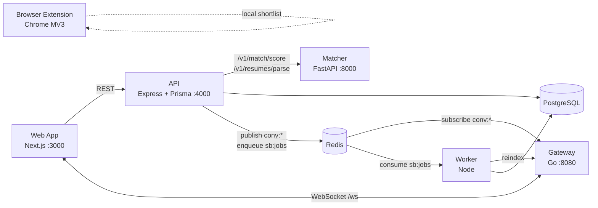

<div align="center">

# SkillBridge

**Skills-first hiring: verified skills, explainable match scores, and real-time conversations between candidates and employers.**

[](https://github.com/your-org/SkillBridge/actions/workflows/ci.yml)
[](LICENSE)
[](https://www.typescriptlang.org/)
[](https://go.dev/)
[](https://www.python.org/)
[](https://www.prisma.io/)
[](https://nodejs.org/)

</div>

---

## Overview

Resume keyword filters reward formatting over ability, and candidates rarely learn why they were passed over. SkillBridge matches people to roles on **demonstrated skills**. Employers define weighted skill requirements for each job. Candidates prove their skills through timed assessments. Every application receives a transparent, reproducible match score that ranks the employer's pipeline. Interview scheduling and messaging happen in the same product.

## Key Features

- **Skill-weighted matching**: required skills count double, shortfalls reduce credit per level, and assessment-verified skills earn a bonus. See [docs/matching.md](docs/matching.md).
- **Skill assessments**: question banks with graded attempts. Passing an assessment verifies the skill on the candidate's profile.
- **Resume parsing**: the Python matcher extracts skills from resumes using a skill taxonomy, alias normalization and seniority keywords.
- **Employer dashboard**: pipeline statistics across application stages, with candidates ranked by match score.
- **Application pipeline**: `SUBMITTED` to `SCREENING` to `INTERVIEW` to `OFFER` to `HIRED`, plus `REJECTED` and `WITHDRAWN`.
- **Interview scheduling**: open 45-minute slot discovery, proposals and confirmation.
- **Real-time messaging**: conversations persisted in Postgres and fanned out over WebSockets through a Go gateway backed by Redis pub/sub.
- **Job search**: cursor-paginated search in the API, plus an in-memory inverted index in the gateway kept fresh by the worker.
- **Browser extension**: a Chrome (Manifest V3) extension that detects a job posting on the current page and saves it to a local shortlist.
- **Background processing**: a worker handles email delivery, search reindexing and job expiry with bounded retries.

## Architecture



Message flow: the API persists a message to Postgres and publishes it to Redis, and the gateway broadcasts it to connected clients. If the matcher is unavailable, the API falls back to a local skill-overlap heuristic. Details are in [docs/architecture.md](docs/architecture.md).

## Tech Stack

| Layer | Technology |
|-------|------------|
| Web | Next.js 14, React 18, TanStack Query |
| API | Node.js 20, Express, Prisma, bcryptjs, JWT |
| Matcher | Python 3.11+, FastAPI |
| Gateway | Go 1.22, WebSockets, Redis pub/sub |
| Worker | Node.js, ioredis, Nodemailer |
| Extension | Chrome Manifest V3 |
| Data | PostgreSQL 16, Redis 7 |
| Tooling | Turborepo, npm workspaces, Vitest, pytest, `go test`, ESLint, Prettier |
| Delivery | Docker, Docker Compose, Kubernetes, GitHub Actions |

## Repository Structure

```
SkillBridge/
├── apps/
│   ├── api/            # Express API (routes, services, middleware, tests)
│   ├── web/            # Next.js app (candidate and employer experiences)
│   ├── worker/         # Redis-backed background jobs (email, reindex, expiry)
│   └── extension/      # Chrome MV3 job-saver extension
├── services/
│   ├── matcher/        # FastAPI scoring + resume parsing (data/, tests/)
│   └── gateway/        # Go WebSocket gateway + search index
├── packages/
│   ├── types/          # Shared TypeScript domain and API types
│   └── utils/          # Shared helpers (retry, pagination, dates)
├── prisma/             # schema.prisma, migrations, seed.ts
├── deploy/             # Dockerfiles, docker-compose.yml, k8s-api.yaml
├── docs/               # api.md, architecture.md, matching.md
├── scripts/            # check-env.js, release-notes.js, generate-fake-candidates.js
├── .github/            # CI, CodeQL, Docker and release workflows
├── Makefile
└── turbo.json
```

## Getting Started

### Prerequisites

- Node.js 20 and npm
- Python 3.11 or newer
- Go 1.22
- Docker with Docker Compose
- PostgreSQL 16 and Redis 7 (provided by Docker Compose)

### Setup

```bash
git clone https://github.com/your-org/SkillBridge.git
cd SkillBridge
npm install

cp .env.example .env
```

Key variables in `.env`:

| Variable | Purpose |
|----------|---------|
| `DATABASE_URL` | PostgreSQL connection string |
| `REDIS_URL` | Redis connection string |
| `JWT_SECRET` | Secret used to sign and verify JWTs; set a long random value |
| `MATCHER_URL` | Matcher service base URL (default `http://localhost:8000`) |
| `GATEWAY_URL` | Gateway base URL (default `http://localhost:8080`) |
| `S3_BUCKET` | Bucket for resume storage |
| `SMTP_HOST` / `SMTP_PORT` | Mail server used by the worker |
| `NEXT_PUBLIC_API_URL` | API URL used by the web app (default `http://localhost:4000`) |

### Run the full stack with Docker

```bash
make up        # docker compose -f deploy/docker-compose.yml up --build -d
make migrate   # npx prisma migrate deploy
make seed      # load seed data
```

| Service | URL |
|---------|-----|
| Web | http://localhost:3000 |
| API | http://localhost:4000 |
| Matcher | http://localhost:8000 |
| Gateway | http://localhost:8080 |

Stop everything with `make down`.

### Run services locally

Start Postgres and Redis (for example, `docker compose -f deploy/docker-compose.yml up -d postgres redis`), then:

```bash
make dev                          # web + API + worker via Turborepo (npm run dev)

# Python matcher
cd services/matcher
pip install -r requirements.txt
uvicorn app.main:app --port 8000

# Go gateway
cd services/gateway
make run                          # targets: build, run, test, lint
```

Other root targets: `make build`, `make lint`, `make test`.

### Browser extension

Open `chrome://extensions`, enable Developer mode, choose **Load unpacked** and select `apps/extension`. See [apps/extension/README.md](apps/extension/README.md).

## API Overview

REST API served by the Express app. Authenticated routes expect a `Bearer` JWT. Full reference: [docs/api.md](docs/api.md).

| Method | Path | Auth | Description |
|--------|------|------|-------------|
| GET | `/healthz` | None | Liveness check |
| POST | `/auth/register` | None | Create an account |
| POST | `/auth/login` | None | Exchange credentials for a JWT |
| GET | `/jobs` | None | Search jobs (cursor pagination) |
| GET | `/jobs/:id` | None | Job detail |
| POST | `/jobs` | Employer | Create a job |
| POST | `/applications` | Any | Apply to a job; match score computed server-side |
| PATCH | `/applications/:id/status` | Any | Advance an application's stage |
| DELETE | `/applications/:id` | Any | Withdraw an application |
| GET | `/assessments/:id` | Any | Fetch an assessment |
| POST | `/assessments/:id/attempts` | Any | Submit answers; passing verifies the skill |
| GET | `/interviews/slots` | Any | Open 45-minute slots for an employer on a date |
| POST | `/interviews` | Any | Propose an interview |
| PATCH | `/interviews/:id/confirm` | Any | Confirm an interview |
| GET | `/messages/conversations` | Any | List conversations |
| POST | `/messages/conversations/:id/messages` | Any | Send a message |
| GET | `/dashboard/summary` | Employer | Pipeline statistics |

**Internal services**

| Service | Endpoints |
|---------|-----------|
| Matcher | `POST /v1/match/score`, `POST /v1/resumes/parse`, `GET /healthz` |
| Gateway | `/ws` (JWT-authenticated WebSocket), `/index/`, `/search`, `/healthz` |

## Data Model

Defined in [`prisma/schema.prisma`](prisma/schema.prisma) with migrations in `prisma/migrations`.

| Area | Models |
|------|--------|
| Identity | `User`, `CandidateProfile`, `Employer`, `EmployerMember` |
| Skills | `Skill`, `CandidateSkill`, `JobSkill` |
| Hiring | `Job`, `Application`, `Interview`, `SavedJob` |
| Assessments | `Assessment`, `AssessmentQuestion`, `AssessmentAttempt` |
| Messaging | `Conversation`, `ConversationParticipant`, `Message` |

Enums: `Role` (`CANDIDATE`, `EMPLOYER`, `ADMIN`), `JobStatus`, `ApplicationStatus`, `SkillLevel`, `InterviewStatus`, `WorkMode`.

## Testing

```bash
make test           # matcher (pytest), gateway (go test), then npm test via Turborepo
make matcher-test   # cd services/matcher && python -m pytest -q
make gateway-test   # cd services/gateway && go test ./...
make lint           # ESLint
```

The API test suite (Vitest) covers health, auth, matching, grading and error handling. GitHub Actions ([ci.yml](.github/workflows/ci.yml)) runs Node lint and tests, Python tests, and Go vet and tests on every pull request. CodeQL analysis runs in [codeql.yml](.github/workflows/codeql.yml).

## Deployment

- **Containers**: each component has a Dockerfile in [`deploy/`](deploy) (`api`, `web`, `matcher`, `gateway`, `worker`). The [docker workflow](.github/workflows/docker.yml) builds and pushes images to GitHub Container Registry.
- **Compose**: `deploy/docker-compose.yml` brings up Postgres, Redis and all services.
- **Kubernetes**: [`deploy/k8s-api.yaml`](deploy/k8s-api.yaml) contains the API deployment manifest.
- **Releases**: pushing a `v*.*.*` tag triggers the [release workflow](.github/workflows/release.yml). Changes are tracked in [CHANGELOG.md](CHANGELOG.md).
- **Migrations**: apply with `make migrate` (`prisma migrate deploy`).

## Security

- Passwords are hashed with bcrypt (cost factor 12).
- Authentication uses signed JWTs; role checks (`CANDIDATE`, `EMPLOYER`, `ADMIN`) are enforced in API middleware. The gateway verifies the same JWT before upgrading a WebSocket connection.
- Request bodies are limited to 1 MB.
- Secrets are supplied via environment variables; never commit `.env`. Use a long random `JWT_SECRET` in every environment.
- CodeQL scanning and Dependabot are enabled.

To report a vulnerability, follow [SECURITY.md](SECURITY.md).

## Roadmap

- Broader assessment catalog and question authoring tools for employers
- Embedding-based semantic matching in the matcher service
- Expanded Kubernetes manifests for the remaining services
- Browser extension sync with the SkillBridge account shortlist
- Richer employer analytics on the dashboard

## Contributing

Contributions are welcome. Please read [CONTRIBUTING.md](CONTRIBUTING.md) and our [Code of Conduct](CODE_OF_CONDUCT.md) before opening a pull request.

## License

Released under the [MIT License](LICENSE).
